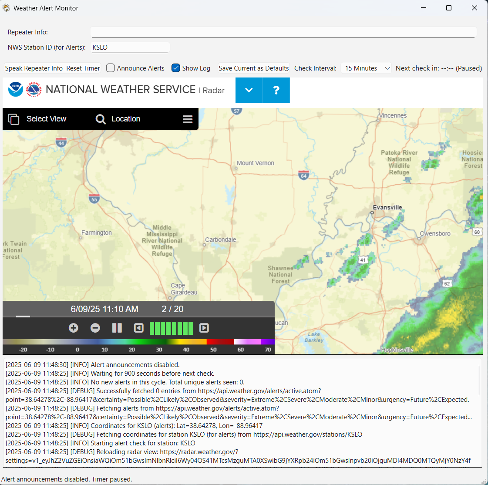

# PyWeatherAlert

PyWeatherAlert is a cross-platform desktop weather monitoring application built with Python and PySide6. It retrieves active alerts and forecasts from the U.S. National Weather Service (NWS), monitors multiple user-defined locations, and can announce important alerts through text-to-speech, desktop notifications, and webhooks.



> PyWeatherAlert is an informational aid. Always follow official NWS guidance and local emergency instructions during severe weather.

## Features

- Monitor multiple locations using a U.S. ZIP code, NWS/airport station ID, latitude and longitude, county or forecast zone, or `City, State`.
- View active alerts, hourly and multi-day forecasts, alert polygons, and weather web sources.
- Filter alerts by severity, certainty, urgency, and alert type.
- Define per-location rules, quiet hours, routing overrides, and escalation behavior.
- Rank alerts by proximity when alert geometry is available.
- Track new, updated, expired, and cancelled alerts while suppressing duplicate notifications.
- Announce alerts and optional repeater/call-sign messages using text-to-speech.
- Send generic, Discord, and Slack webhook notifications.
- Review durable per-channel delivery results, safe retries, and uncertain outcomes in **Incidents > Operations**.
- Group monitored locations and acknowledge individual alert revisions with operator notes.
- Keep valid warnings available when forecasts or marine data fail; inspect retrieval and observation times for each source.
- Browse alert history and export incident data to JSON, CSV, or PDF.
- Use light and dark themes, switch between hourly and five-day forecasts, and save adjustable panel sizes.
- Pause or resume monitoring independently from spoken announcements.
- Continue displaying cached data during temporary API outages.
- Keep the last available weather visible during refresh, with distinct loading, cached, and unavailable states.
- Use keyboard shortcuts: **F5** to refresh, **Ctrl+,** for Preferences, and **Enter** on a selected alert to open its details.

## Requirements

- Python 3.10 or newer is recommended.
- Internet access to retrieve NWS alerts, forecasts, maps, and other web content.
- A supported text-to-speech engine if audio announcements are enabled.

The application is designed primarily for U.S. locations because it uses National Weather Service services.

## Installation

Clone the repository and enter its directory:

```bash
git clone https://github.com/nicarley/PythonWeatherAlerts.git
cd PythonWeatherAlerts
```

Create and activate a virtual environment.

Windows PowerShell:

```powershell
python -m venv .venv
.\.venv\Scripts\Activate.ps1
```

macOS or Linux:

```bash
python3 -m venv .venv
source .venv/bin/activate
```

Install the dependencies:

```bash
python -m pip install --upgrade pip
python -m pip install -r requirements.txt
```

## Running the application

Start the graphical application from the project root:

```bash
python PyWeatherAlertGui.py
```

On first launch, the setup assistant helps you choose a location and monitoring options. Use **File > Preferences** afterward to:

1. Add one or more locations.
2. Choose the weather-check interval.
3. Configure alert filters and notification routes.
4. Enable alert announcements if desired.

Accepted location examples include:

| Input type | Example |
| --- | --- |
| ZIP code | `62881` |
| Airport/NWS station | `KSTL` |
| Coordinates | `38.63,-90.20` |
| County/zone ID | `ILC163` |
| City and state | `St Louis, MO` |

The repository also contains `PyWeatherAlert.py`, a smaller command-line monitor. Its station, interval, and repeater message are configured as constants near the top of that file:

```bash
python PyWeatherAlert.py
```

## Settings and application data

The GUI stores versioned settings and alert history, operations.sqlite3 (acknowledgments, metrics, and last-known weather), and delivery.sqlite3 (notification recovery and deduplication) in the platform-specific local application-data directory under PythonWeatherAlerts. Preserve these databases when upgrading. User data is separate from the packaged application.

Webhook credentials use the operating system credential store through keyring. Existing plaintext settings migrate when secure storage succeeds. If the store is unavailable, new credentials work for the current session and the app warns that they were not saved securely; an existing legacy value is retained until migration succeeds. **Backup Settings** excludes webhook credentials, so configure them again on the destination machine. Backups still contain location information.

**Help > Export diagnostics** creates a local support archive with aggregate source health, package versions, and delivery outcomes. It excludes location identifiers, settings, notification payloads, and credentials. Nothing is uploaded automatically.

A notification marked **Provider accepted** has been accepted by the external service. Human acknowledgment is recorded separately. Uncertain outcomes are not automatically resent. Saved pending warnings wait for a fresh alert check before recovery, and expired or cancelled warnings are removed from pending work.

## Running tests

Install pytest and run the suite from the project root:

```bash
python -m pip install -r requirements-test.txt
python -m pytest
python PyWeatherAlertGui.py --smoke-test
```

Tests cover partial outages, obsolete responses, delivery recovery, speech ownership, settings and history migrations, alert rules, lifecycle, incident exports, and desktop state transitions. Desktop and smoke tests use isolated data and inert external adapters. They do not send live notifications. Shared behavior fixtures and current native iPad limitations are documented in [the platform contract](docs/platform-contract.md).

## Building a desktop package

Install PyInstaller separately if you want to package the application:

```bash
python -m pip install pyinstaller
```

Use build_release.py on the target operating system, or the Windows/macOS wrappers in resources. The release helper reads the authoritative versionnumber in PyWeatherAlertGui.py, validates its yy.mm.dd.buildnumber format, and checks the packaged app with the offline smoke test. Release artifacts include dependency and checksum evidence. Signing requires owner credentials; a local build does not imply a signed or published release.

See [release readiness](docs/release-readiness.md) and the [operator pilot protocol](docs/pilot-validation.md) for validation evidence and remaining external checks.

## Project structure

```text
PythonWeatherAlerts/
|-- PyWeatherAlertGui.py     # Main PySide6 desktop application
|-- PyWeatherAlert.py        # Lightweight command-line monitor
|-- weather_alert/           # Reusable application services
|-- tests/                   # Pytest test suite
|-- resources/               # Icons, stylesheets, defaults, and build scripts
|-- iOS/                     # Native iOS companion project
|-- requirements.txt         # Python dependencies
`-- README.md
```

Core services in `weather_alert/` handle NWS API access, settings, history, rules, proximity, escalation, notification delivery, duplicate suppression, security, marine data, and incident exports.

## Troubleshooting

- **No location data:** Confirm the location format and verify that `api.weather.gov` is reachable.
- **No embedded web view:** Reinstall or upgrade PySide6; the application continues with web-view features disabled if `QtWebEngineWidgets` is unavailable.
- **No audio:** Check the operating system's speech engine and output device, then confirm that audio is enabled and not muted in Preferences.
- **No webhook message:** Verify the credential and enable both the global channel and the location webhook rule. Use **Send Test Notifications**, then inspect **Operations**. Queued warnings await a fresh source check; uncertain outcomes require checking the receiving service.
- **Stale information:** Check the in-app log and connection state. Cached data may be shown when an upstream service is unavailable.

## Data sources and privacy

Weather data is retrieved from the [National Weather Service API](https://www.weather.gov/documentation/services-web-api). Optional web sources and notification channels connect directly to their respective third-party services. Location values, preferences, alert history, and webhook configuration are stored locally by the desktop application.

## License

No license file is currently included in this repository. Unless the project owner adds a license, copyright law reserves reuse and distribution rights.
